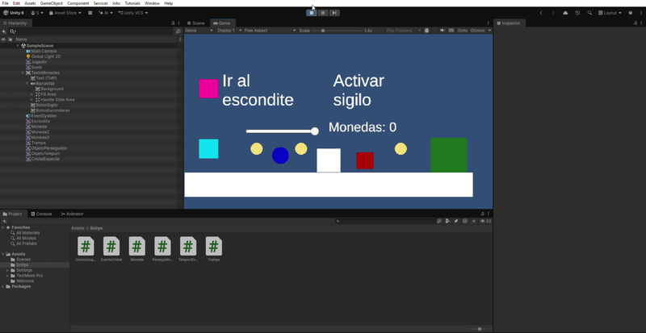

# Práctica: Eventos en Unity 2D

## 1. Objetivo

El objetivo de esta práctica es experimentar con las diferentes modalidades de uso de eventos para enviar mensajes entre los objetos de una escena en Unity.

Se trabajan los eventos de la interfaz de usuario (UI), los eventos del sistema y los eventos personalizados mediante C# (delegados y patrón observador).

## 2. Mecánicas implementadas

### Interfaz de usuario (UI)

- Botón para activar y desactivar el modo sigilo, reduciendo la velocidad del jugador.
- Contador de monedas que aumenta al recoger objetos.
- Barra de vida que disminuye al tocar una trampa.
- Botón para desplazarse progresivamente hasta el escondite.

### Eventos personalizados de C#

Se ha implementado un evento personalizado que se activa cuando el jugador recoge un cristal especial.

Al activarse el evento, dos objetos reaccionan simultáneamente:

- **Objeto perseguidor:** comienza a desplazarse suavemente hacia el jugador.
- **Objeto teleportador:** se teletransporta a una posición determinada de la escena.

Para implementar esta mecánica se ha utilizado un evento de C# que permite comunicar varios objetos sin necesidad de que estén directamente relacionados entre sí.

## 3. Scripts utilizados

- `ControlJugador.cs`: controla el movimiento del jugador, el modo sigilo, el escondite, el contador de monedas y la barra de vida.
- `Moneda.cs`: detecta cuándo el jugador recoge una moneda y actualiza el contador.
- `Trampa.cs`: detecta el contacto con una trampa y reduce la vida del jugador.
- `EventoCristal.cs`: declara y lanza el evento cuando se recoge el cristal especial.
- `PerseguidorEvento.cs`: escucha el evento y hace que el objeto perseguidor siga al jugador.
- `TeleportEvento.cs`: escucha el mismo evento y teletransporta el segundo objeto.

## 4. Ejecución de la práctica

A continuación se muestra un GIF con el funcionamiento de las mecánicas implementadas.

## 5. Herramientas utilizadas

- Unity 6
- Lenguaje de programación C#
- Visual Studio
- Git y GitHub

## 6. Conclusión

Con esta práctica se ha aprendido a utilizar diferentes tipos de eventos en Unity, tanto los relacionados con la interfaz de usuario como los eventos personalizados de C#.

También se ha trabajado la comunicación entre objetos, permitiendo que varios elementos reaccionen simultáneamente ante una misma acción del jugador.
